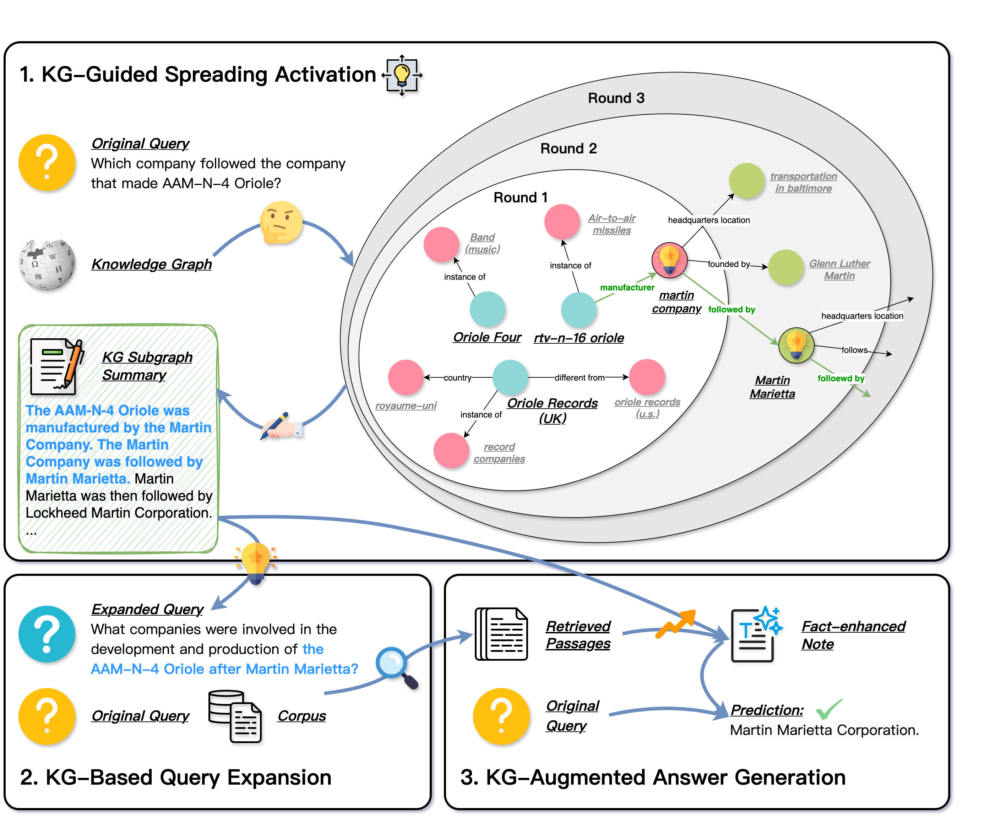

# KG-Infused RAG
This repository is the official implementation of [KG-Infused RAG: Augmenting Corpus-Based RAG with External Knowledge Graphs](https://arxiv.org/pdf/2506.09542).


## 🧭 Overview
We propose <b>KG-Infused RAG</b>, a framework that integrates pre-existing, large-scale KGs to enhance retrieval and generation. At its core, KG-Infused RAG employs 🧠<b><i>spreading activation</i></b>, a concept from cognitive psychology in which activation propagates from a central concept to related ones in a semantic network.
<div align="center">
  
</div>
The framework consists of three modules that together enable interpretable, fact-grounded multi-source retrieval:
1) <b>KG-Guided Spreading Activation</b>, 
2) <b>KG-Based Query Expansion</b>, and 
3) <b>KG-Augmented Answer Generation</b>.


## 🛠️ Setup
### 1. Environment
Step 1: clone this repo
```bash
git clone git@github.com:thunlp/KG-Infused-RAG.git
cd KG-Infused-RAG
```

Step 2: Create environment and install dependencies
```bash
conda create -n kg-infused-rag python=3.10
conda activate kg-infused-rag
pip install -r requirements.txt
pip install -e .
```

### 2. Data Preparation
#### Datasets
All evaluation and training data can be downloaded [here](https://drive.google.com/drive/folders/1GfkVZhjHJidCprIyeUuIGdyVJgauC-c1?usp=drive_link). Place the data under the `./data/datasets` directory. The data is organized into two parts:

- Evaluation Data: Includes the original test set and the corresponding initial retrieval results from both the corpus and the knowledge graph.

- Training Data: Contains the original sampling outputs on the training set, as well as the constructed DPO training data derived from them.


#### Corpus and Knowledge Graph
Download the corpus, unzip the file and place the extracted data under the `./data/corpus` directory:
```bash
mkdir -p data/corpus
cd data/corpus
wget https://dl.fbaipublicfiles.com/dpr/wikipedia_split/psgs_w100.tsv.gz
gunzip psgs_w100.tsv.gz
```

The knowledge graph used in our experiments are available via both 🤗 [Hugging Face](https://huggingface.co/datasets/Alphonse7/Wikidata5M-KG) and [ModelScope](https://modelscope.cn/datasets/alphonse7/Wikidata5m-KG). Download the KG (Wikidata5M-KG), unzip the file and place the extracted data under the `./data/KG` directory:

```bash
mkdir -p data/KG
tar -xzvf wikidata5m_kg.tar.gz -C data/KG
```

Generate the embedding of the passages from corpus and entity descriptions from Wikidata5M-KG:
```bash
bash ./scripts/generate_embeddings_corpus.sh
bash ./scripts/generate_embeddings_kg.sh
```


### 3. Model
- Retriever: `Contriever-MS MARCO`
- Generator: Models from the `Qwen2.5` series, `LLaMA3.1` series, and `GPT` family, including GPT-4o-mini and GPT-4o.


## 🚀 Implementation and Experiments
### (Optional) Initial Retrieval 
You can pre-retrieve top-k passages from the corpus and relevant entities from the KG for each input question to **save time** during the main pipeline:

```bash
bash ./scripts/retrieval.sh
```

> 💡 **Precomputed retrieval results** are available [here](https://drive.google.com/drive/folders/1GfkVZhjHJidCprIyeUuIGdyVJgauC-c1?usp=drive_link) (see *Evaluation Data* in [Datasets](#datasets)).

### 1. Main Pipeline
```bash
bash ./scripts/kg_infused_rag.sh
```

### 2. Training (DPO)

#### 2.1 Build DPO data
**a) Collect sampling data**: Run the main pipeline multiple times while varying generation parameters (e.g., `temperature`, `top_p`) for the target generation stage to obtain diverse responses. Save the raw outputs under a folder such as `./data/sampling_results_for_dpo_data_construction/{stage}/`.

**b)Construct DPO pairs**: Use the script below to turn the sampling data into DPO-formatted training examples:
```bash
cd train
python generate_dpo_data.py
```

We provide example raw sampling data and the constructed DPO pairs [here](https://drive.google.com/drive/folders/1GfkVZhjHJidCprIyeUuIGdyVJgauC-c1?usp=drive_link).


#### 2.2 Run DPO training
```bash
bash train.sh
```

## 📄 Cite
If you find our code, data, models, or the paper useful, please cite the [paper](https://arxiv.org/pdf/2506.09542):
```
@article{wu2025kg,
  title={KG-Infused RAG: Augmenting Corpus-Based RAG with External Knowledge Graphs},
  author={Wu, Dingjun and Yan, Yukun and Liu, Zhenghao and Liu, Zhiyuan and Sun, Maosong},
  journal={arXiv preprint arXiv:2506.09542},
  year={2025}
}
```
